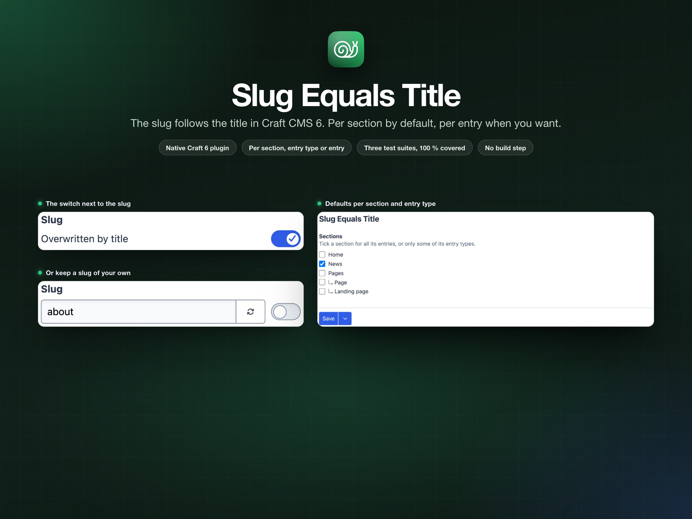

# Slug Equals Title for Craft CMS 6

**The slug follows the title. Per section by default, per entry when you want.**

Craft fills in the slug once, when an entry is new. Rename the entry later and the slug stays behind. This plugin keeps the two together: for the sections and entry types you pick, every save from the editor sets the slug from the title. Each entry has a switch next to its slug field to opt out (or in) and keep a slug of its own.

This is the Craft 6 version (4.x). Sites on Craft 5 use [3.x](https://github.com/internetztube/craft-slug-equals-title/tree/3.x); [`UPGRADE.md`](UPGRADE.md) lists what changes.



[Tour with screenshots](docs/README.md) · [Installation](#installation) · [How it decides](#how-it-decides) · [Configuration](#configuration)

## What you get

- **A switch next to the slug field.** "Slug equals title", a native Craft lightswitch in the editor sidebar of entries, on edit pages and in slideouts. While it is on, every save from the editor sets the slug from the title.
- **Defaults per section.** Tick the sections, or single entry types of a section, in the plugin settings, or set them per environment in `config/craft/slug-equals-title.php`. Their entries follow their title unless their switch says otherwise.
- **Remembered per entry.** The switch is stored with the entry, so later editor saves, `php artisan craft:resave:entries` and other console saves do what the editor decided. Drafts take the choice of their entry until they make their own.
- **Craft's rules.** The slug is made the way Craft makes it for new entries: the site's language (ß → ss, ü → ue in German sites), `limitAutoSlugsToAscii`, and a unique URI (`-2`) when two titles collide.
- **Stop words, if you want them.** List words per site language in the settings (or the config file) and they fall out of the title before it becomes the slug: "A weekend in Hong Kong" → `weekend-hong-kong`. Whole words, any case; a title of nothing but stop words keeps every word. Empty by default, so nothing changes unless you list words. The config file ships example lists for every language Craft speaks, commented out.
- **Nothing else is touched.** Entries switched off, revisions, nested entries (Matrix) and entries without a title keep their slug. Saves without an editor (queue jobs, index actions, imports, other plugins) leave slugs alone.

## Tested

Three test suites run on every push, on PHP 8.5, on MySQL 8 and PostgreSQL 14: the console, the control panel over HTTP, and the control panel in headless Chrome. 100 % line coverage of `src/`. [`dev/TESTS.md`](dev/TESTS.md) lists every check in one sentence.

## Requirements

Craft CMS 6.0 (alpha 20 or later) and PHP 8.5. A native Craft 6 plugin: no Yii2 adapter, no compatibility layer. Entries only (see below).

## Installation

Install from the Plugin Store in the control panel, or with Composer:

```sh
composer require internetztube/craft-slug-equals-title:^4.0
php artisan craft:plugin:install slug-equals-title
```

Then tick the sections (or single entry types) under Settings → Slug Equals Title.

Updating from Craft 5: be on 3.1.0 or later first (the update needs its table), then follow [`UPGRADE.md`](UPGRADE.md). The remembered choices and the settings carry over.

## How it decides

On every save of an entry with a title, the plugin asks in this order:

1. **The editor.** Saved from an edit page or a slideout, the switch decides. Craft 6's edit page posts only what changed, so a switch left as it was means the choice it showed: the remembered one, or the section's default. A switch that was toggled is remembered for the entry.
2. **The console.** Saved by `craft:resave:entries`, a migration or another Artisan command, the element's remembered choice decides; an element that never made one follows the plugin settings for its section (or entry type). A draft without a choice takes its canonical entry's.
3. **Anything else** in a web request that does not name the entry (index actions on many entries, other entries a plugin saves along) leaves the slug alone.

When the answer is yes, the slug is set from the title with Craft's own `ElementHelper::generateSlug()` in the site's language, and Craft's validators normalize it and keep the URI unique. When the answer is no, the slug stays what it is.

So after turning a section on, `php artisan craft:resave:entries --section=news` brings every entry in line, except the ones an editor switched off.

## Configuration

Copy [`config/slug-equals-title.php`](config/slug-equals-title.php) to `config/craft/slug-equals-title.php` to set the defaults per environment. Settings from the file win over the control panel and are shown there read-only:

```php
return [
    'enabledSections' => ['news', 'pages:landingPage'],   // sections, or "section:entryType"
    'stopWords' => [                                     // dropped from the title before it becomes the slug, per site language
        'en' => ['a', 'an', 'and', 'the', 'of'],
        'de' => ['der', 'die', 'das', 'und'],
    ],
];
```

[`config/slug-equals-title.php`](config/slug-equals-title.php) carries an example stop-word list for every language Craft speaks, commented out: uncomment yours and trim it. Japanese, Korean, Chinese and Thai have no spaces between words, so there is nothing to drop there.

Sections are named by handle here; the settings page stores UIDs (a renamed handle keeps its setting), and both are accepted everywhere.

## Supported element types

Entries of a section. Matrix blocks are entries without one and are left alone; entry types that hide the slug field show no switch.

Categories and Craft Commerce products exist in Craft 6 only through compatibility layers (Craft's Yii2 adapter), which this native plugin does not use. 3.x supports them on Craft 5.

## Screenshots

Every part of it, shown in the dev project: [docs/README.md](docs/README.md).

## Development

`dev/dev.sh` creates a throwaway Craft 6 project (a Laravel app) with a German site, seeds the sections and the demo content (a travel journal, "Transit") and starts a server at http://localhost:8130/admin (admin / password).

```sh
dev/dev.sh                     # setup + serve (PostgreSQL)
DB_DRIVER=mysql PROJECT_DIR=../craft-slug-equals-title-dev6-mysql PORT=8131 dev/dev.sh
dev/dev.sh smoke                # seed and run dev/smoke.php (the console)
dev/dev.sh e2e                  # the control panel over HTTP
dev/dev.sh ui                   # the control panel in headless Chrome
dev/dev.sh screenshots          # retake docs/screenshots
vendor/bin/phpstan              # static analysis (Larastan, level 9)
```

GitHub Actions runs PHPStan and the three suites with coverage on PHP 8.5, on MySQL 8 and PostgreSQL 14.

## Support

Please report issues and feature requests on [GitHub](https://github.com/internetztube/craft-slug-equals-title/issues).

Icon made by [Freepik](https://www.flaticon.com/authors/freepik) from [www.flaticon.com](https://www.flaticon.com/), licensed [CC 3.0 BY](http://creativecommons.org/licenses/by/3.0/).

Brought to you by [Frederic Koeberl](https://frederickoeberl.com/)
