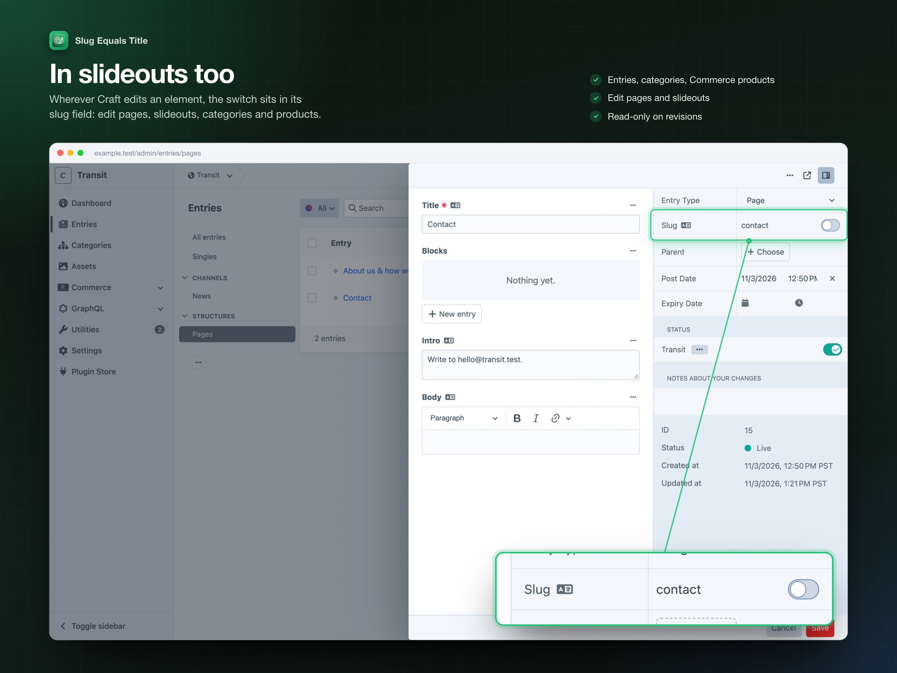
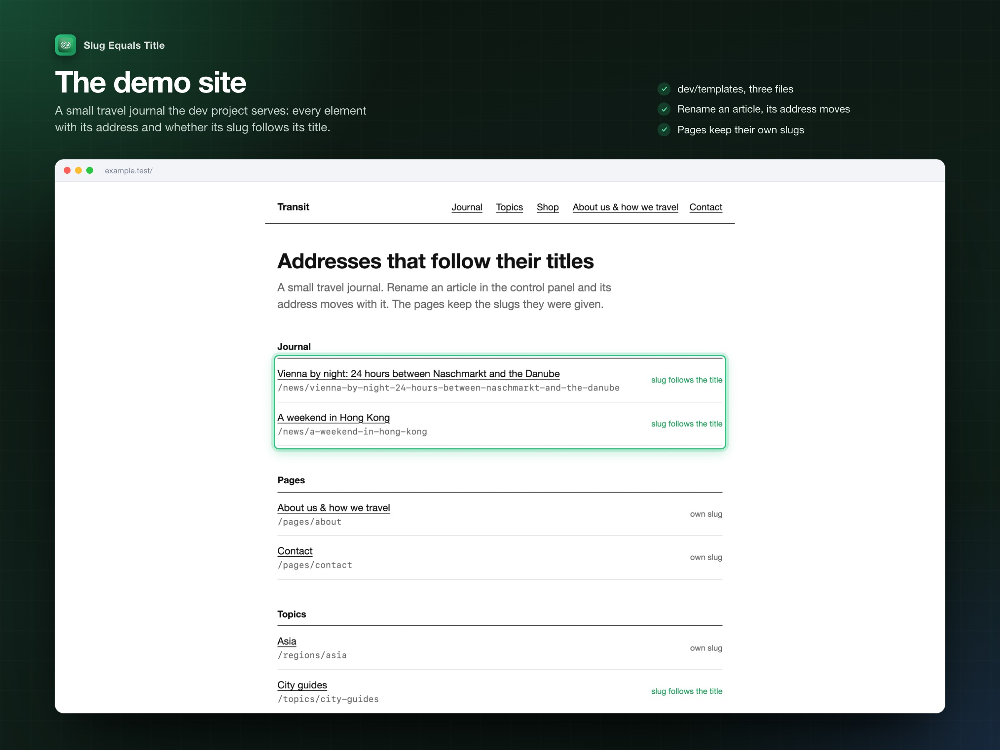

# Slug Equals Title: a tour

Every part of the plugin, shown in the dev project that `dev/dev.sh` builds (a travel site with a News section, a Pages section, a German site and a Commerce product type). Each picture shows the whole control panel page; where the feature is small, an inset zooms in. `dev/dev.sh screenshots` retakes every picture on this page.

## The slug follows the title

In the sections you picked, the switch in the slug field is on: the slug input is locked and shows the slug the title will get, as you type. On save, Craft's own slug rules apply: the site's language, `limitAutoSlugsToAscii`, and a unique URI when two titles collide.

## Or keep a slug of your own

Switch it off for one entry and the slug field is free again. The choice is remembered with the entry: `resave/entries` and other console saves keep its slug too. Entries of sections that are off start this way.

## In slideouts too

Wherever Craft edits an element, the switch sits in its slug field: edit pages, slideouts, entries, categories and Craft Commerce products. Revisions show it read-only. Entry types that hide the slug field show no switch.

## The demo site

The dev project's front end: every article, page, topic and product with its address, and whether its slug follows its title (through the plugin's service, `craft.app.plugins.getPlugin('slug-equals-title').slugs.isEnabled(element)`). Rename an article in the control panel and its address moves.

## Defaults per section

Tick the sections, category groups and product types whose elements follow their title. A section with several entry types lists them under it, so one entry type can be on while the rest of the section is off. Lists set in `config/slug-equals-title.php` win and are shown read-only.

