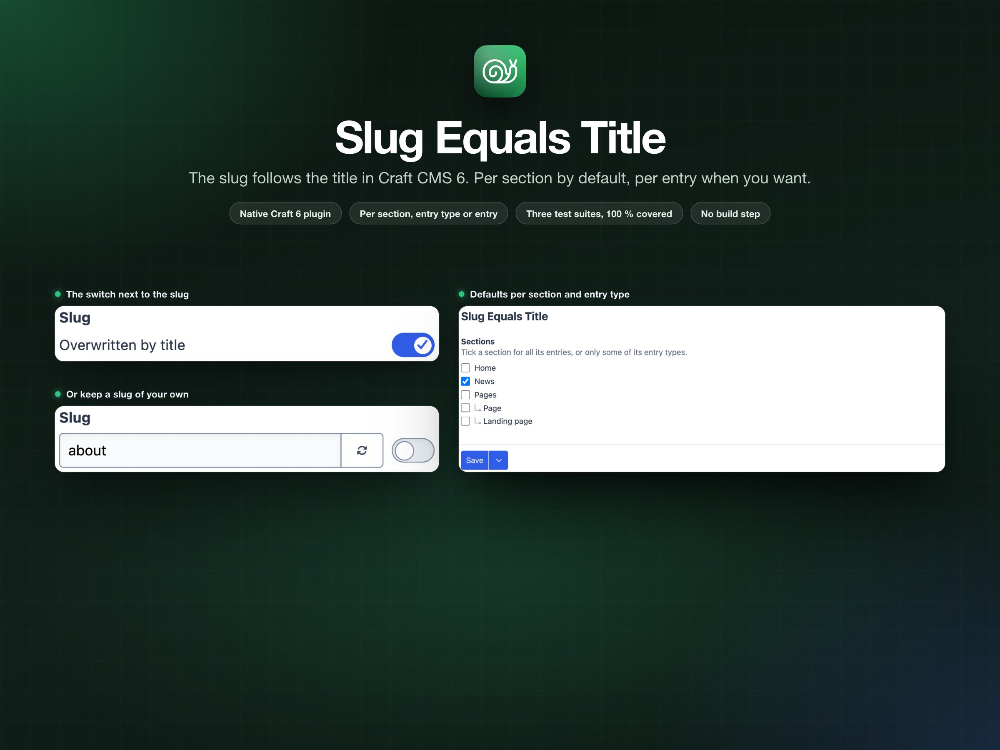
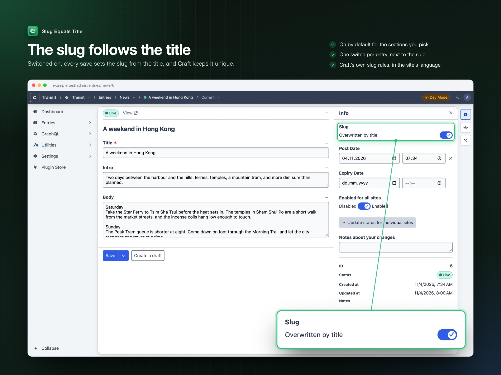
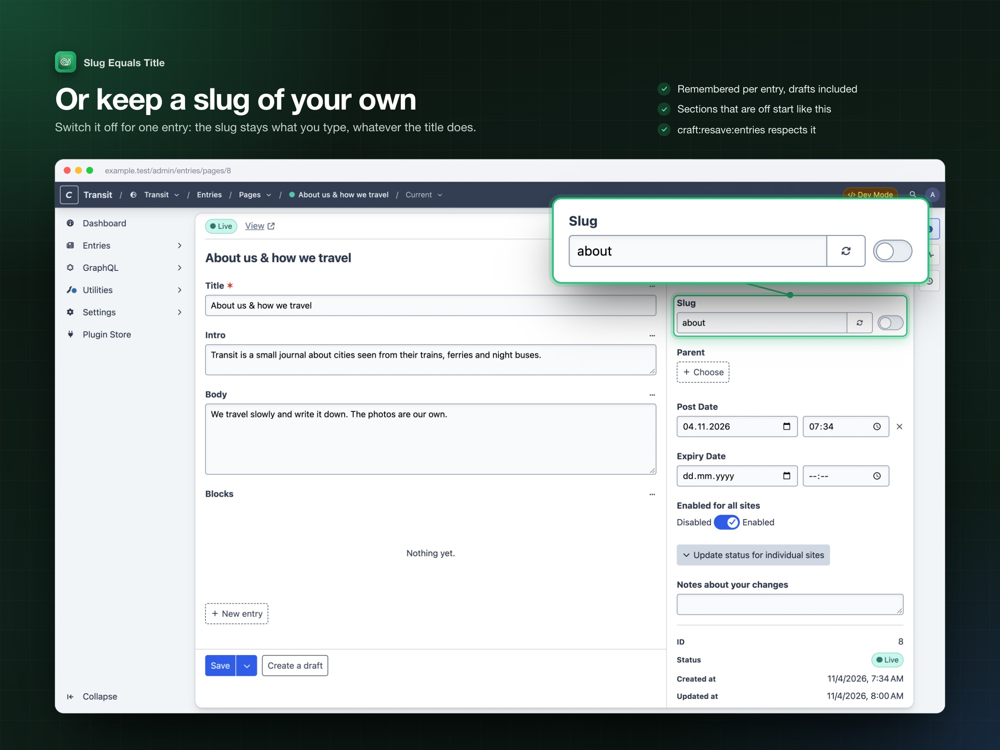
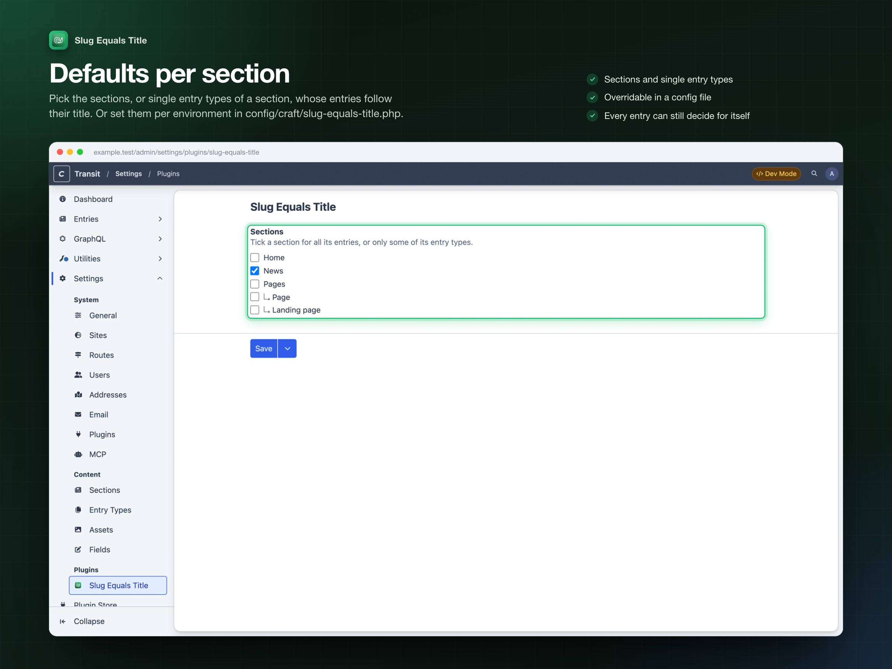

# Slug Equals Title: a tour

Every part of the plugin, shown in the Craft 6 dev project that `dev/dev.sh` builds (a travel journal, "Transit", with a News section, a Pages section and a German site). Each picture shows the whole control panel page; where the feature is small, an inset zooms in. `dev/dev.sh screenshots` retakes every picture on this page.

## The slug follows the title

In the sections you picked, the switch next to the slug field is on: every save from the editor sets the slug from the title. Craft's own slug rules apply: the site's language, `limitAutoSlugsToAscii`, and a unique URI when two titles collide.

## Or keep a slug of your own

Switch it off for one entry and the slug stays what you type. The choice is remembered with the entry: later editor saves, `craft:resave:entries` and other console saves keep its slug too. Entries of sections that are off start this way.

## In slideouts too

Wherever Craft edits an entry, the switch sits in its slug field, next to the input: Craft 6's edit pages and the slideouts. While it is on, “Overwritten by title” takes the input's place. Revisions show it read-only. Entry types that hide the slug field show no switch.

## Defaults per section

Tick the sections, or single entry types of a section, whose entries follow their title. A section with several entry types lists them under it, so one entry type can be on while the rest of the section is off. Lists set in `config/craft/slug-equals-title.php` win and are shown read-only.

